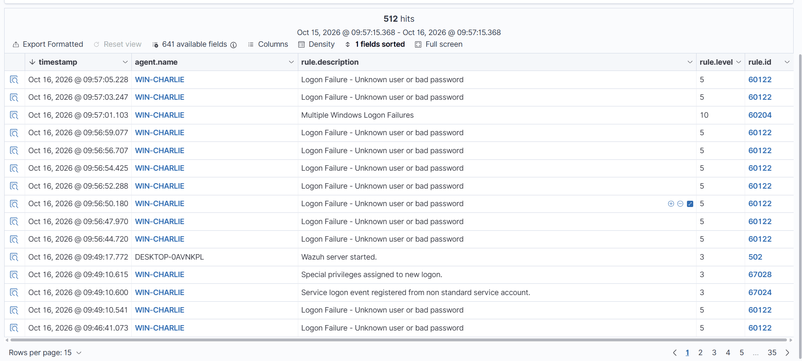
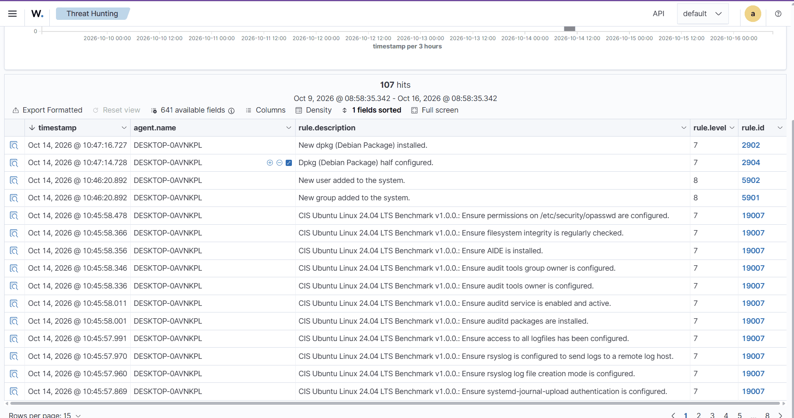
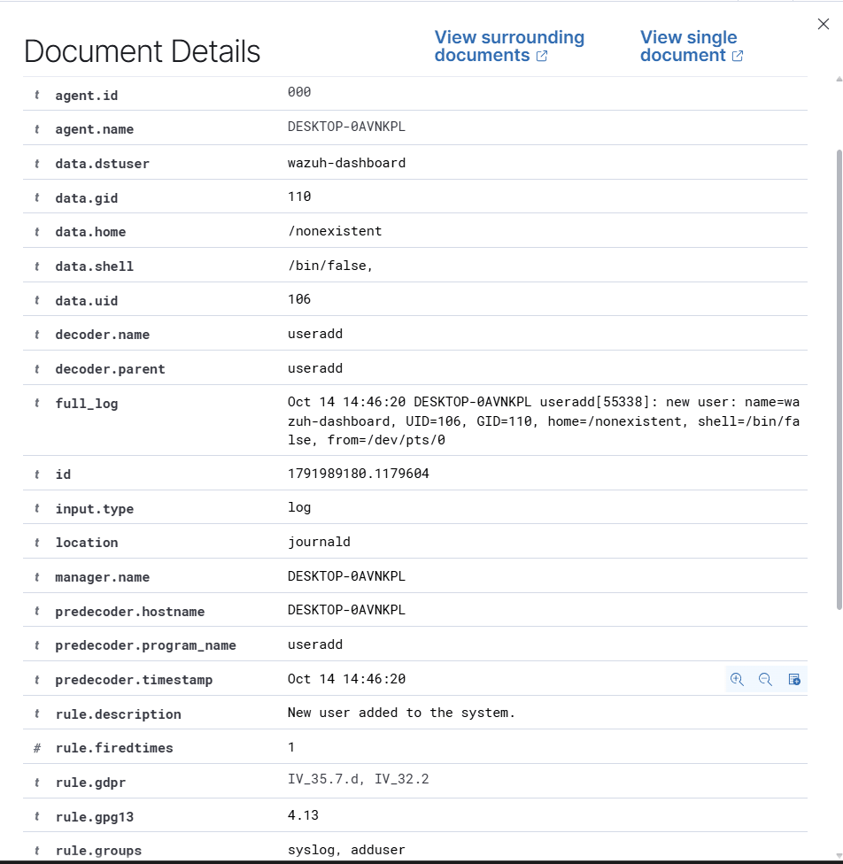
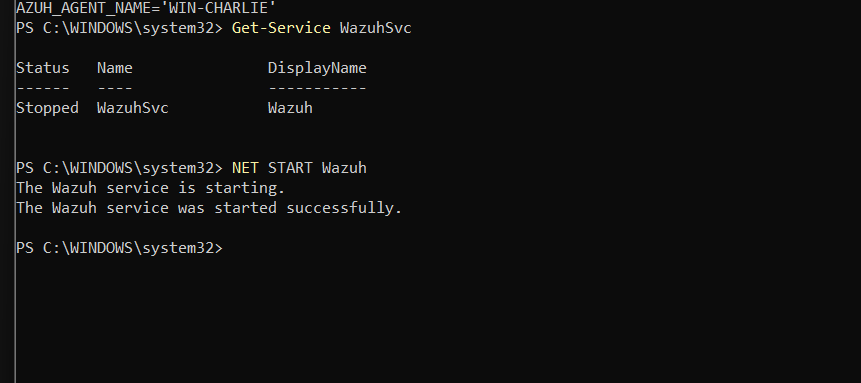
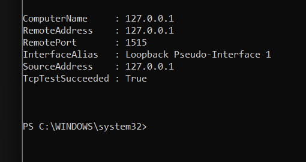
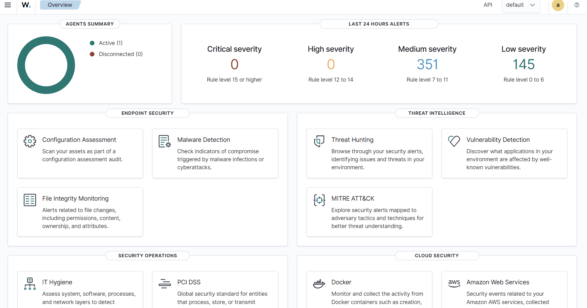
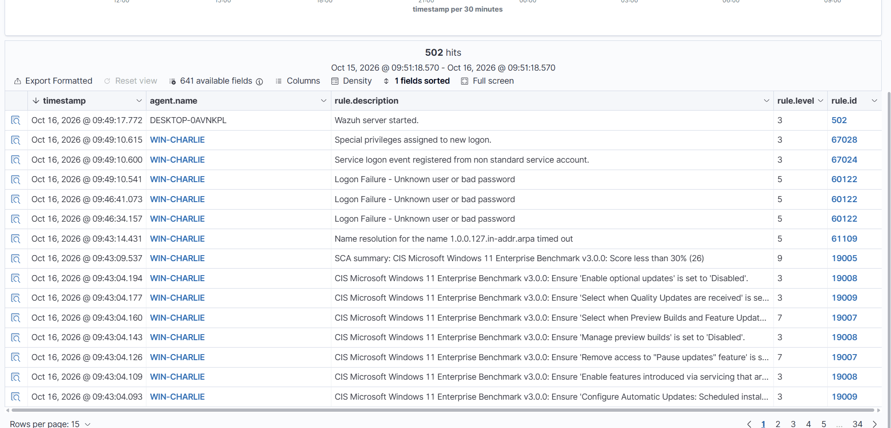

# Wazuh SIEM — Windows Brute-Force Detection (Event ID 4625)

- **Author:** Charlie Figueroa
- **Tools:** Wazuh 4.14.9 (all-in-one) · Ubuntu on WSL2 · Wazuh agent for Windows 11 · PowerShell · Windows Security Event Log
- **Skills shown:** SIEM deployment, endpoint agent enrollment, alert triage, Windows event analysis (4625), brute-force detection, MITRE ATT&CK validation, troubleshooting, ticket documentation



---

## Summary

I deployed Wazuh, an open-source SIEM/XDR, on Ubuntu (WSL2) and enrolled my Windows 11 workstation as a monitored endpoint. I triaged the first alerts the platform generated, then simulated a network brute-force attack against the workstation. Wazuh correlated ten individual failed logons (Event ID 4625) into a single level-10 **brute-force alert (rule 60204, MITRE T1110)**. I investigated the alert like a Tier 1 analyst and documented the verdict in a ticket.

This project is the Windows counterpart of [project 08](../08-splunk-brute-force-detection), where I built the same kind of detection by hand in Splunk. Here the detection rule already existed, so the work moved to deployment, triage and investigation.

> All activity was generated by me in a controlled lab. The simulated attack targeted a non-existent account to avoid locking any real user.

---

## 1. Architecture

| Component | Role |
|---|---|
| Wazuh indexer (port 9200) | Stores and indexes alerts |
| Wazuh server / manager | Receives agent data and applies detection rules |
| Filebeat | Ships alerts from the manager to the indexer |
| Wazuh dashboard (port 443) | Web interface for searching and triage |
| Wazuh agent `WIN-CHARLIE` | Collects the Windows Security event log and forwards it (enrollment on TCP 1515, data on TCP 1514) |

Installed with the official all-in-one script:

```bash
curl -sO https://packages.wazuh.com/4.14/wazuh-install.sh && sudo bash ./wazuh-install.sh -a
```

## 2. Initial triage: 107 alerts on day one

Before any endpoint was enrolled, the Wazuh server was already monitoring itself and produced 107 medium-severity alerts. Instead of reading them one by one, I **grouped them by rule** (`rule.level >= 7`, last 7 days):

| Rule | What it is | Verdict |
|---|---|---|
| 19007 (CIS Ubuntu 24.04 benchmark) | Configuration-assessment findings | Not an incident: hardening recommendations |
| 2902 / 2904 | Packages installed by dpkg | Benign: timestamps match the Wazuh installation |
| **5902 / 5901 (level 8)** | **New user / group added** | Investigated → benign |



A new account is a classic persistence technique (the Linux equivalent of Windows Event ID 4720), so I opened the event instead of assuming:

| Field | Value | Reading |
|---|---|---|
| `data.dstuser` | `wazuh-dashboard` | Named after the installed component |
| `data.uid` | 106 | Below 1000 → system/service account |
| `data.shell` | `/bin/false` | Cannot log in interactively |
| `data.home` | `/nonexistent` | No home directory |



**Ticket:** *Alert 5902 "New user added" (level 8), host DESKTOP-0AVNKPL. User `wazuh-dashboard`, UID 106, shell /bin/false, no home. Created 2026-10-14 14:46 UTC during the authorized Wazuh installation. Service account with no login capability → benign, closed.*

## 3. Enrolling the Windows endpoint

The agent was deployed from the dashboard wizard and installed from an elevated PowerShell session:

```powershell
Invoke-WebRequest -Uri https://packages.wazuh.com/4.x/windows/wazuh-agent-4.14.9-1.msi -OutFile $env:tmp\wazuh-agent; msiexec.exe /i $env:tmp\wazuh-agent /q WAZUH_MANAGER='127.0.0.1' WAZUH_AGENT_NAME='WIN-CHARLIE'
NET START Wazuh
```

Verification at every step instead of assuming success:

```powershell
Get-Service WazuhSvc                       # is the service installed?
Test-NetConnection 127.0.0.1 -Port 1515    # can the agent reach the enrollment port?
```

 



As soon as the agent connected, medium alerts jumped from 0 to 351. This was the **CIS Windows 11 configuration baseline**, not an attack. One finding is worth reporting in a real environment: *"SCA summary: score less than 30%"* (level 9).

## 4. Single failed logons: noise

Three failed `runas` attempts with a wrong password produced three Event ID 4625 records, which Wazuh mapped to **rule 60122, level 5**. One failed logon on its own is normal user behavior.



Search used:

```
agent.name:WIN-CHARLIE and data.win.system.eventID:4625
```

## 5. Simulated brute-force attack

Ten network logon attempts in a few seconds against a non-existent account (`hacker_test`), over SMB/NTLM:

```powershell
1..10 | ForEach-Object { net use \\127.0.0.1\IPC$ /user:hacker_test Clave$_ 2>$null }
```

### Timeline (UTC, 2026-10-16)

| Time | Event | Rule | Level |
|---|---|---|---|
| 13:56:43 – 13:56:59 | 8 × Event ID 4625, account `hacker_test` | 60122 | 5 |
| **13:57:01** | **"Multiple Windows Logon Failures"** (8 failures correlated) | **60204** | **10** |
| 13:57:03 – 13:57:05 | 2 more 4625 events | 60122 | 5 |

The correlation rule fires after **8 failures** (`rule.frequency: 8`), and the alert carries the previous failures in `previous_output`, so the evidence is attached to the alert itself.

### Investigation: interactive mistake vs. network attack

| Field | `runas` test | Brute-force attack | What it tells the analyst |
|---|---|---|---|
| `targetUserName` | Core-i7-Vpro | `hacker_test` | Real account vs. guessed name |
| `logonType` | 2 (interactive) | **3 (network)** | Attempt came over the network |
| `subStatus` | 0xC000006A | **0xC0000064** | Bad password on a valid account vs. **user does not exist** (account guessing / spraying) |
| `ipAddress` / `ipPort` | ::1 / 0 | 127.0.0.1 / 54168 → 54179 | Network source with sequential ports |
| `logonProcessName` / package | seclogo (runas) | NtLmSsp / NTLM | Secondary Logon vs. network authentication (SMB) |

**Signs of automation:** one attempt every ~2 seconds at a perfectly regular rhythm, and consecutive source ports. A person mistyping a password does not behave like that.

### MITRE ATT&CK: validate, don't trust

| Rule | Wazuh mapping | Analyst assessment |
|---|---|---|
| 60122 (single failure) | T1531 Account Access Removal (Impact) | Questionable for a single failed logon |
| 60204 (correlated failures) | **T1110 Brute Force (Credential Access)** | Correct; given SubStatus 0xC0000064, **T1110.003 Password Spraying** / account guessing is also a fit |

### Ticket

> **Alert 60204 "Multiple Windows Logon Failures"** (level 10, MITRE T1110), host WIN-CHARLIE (DESKTOP-0AVNKPL). Ten Event ID 4625 records between 13:56:43 and 13:57:05 UTC against the non-existent account `hacker_test`, Logon Type 3 (network), NTLM, source 127.0.0.1, SubStatus 0xC0000064 (unknown user). Regular ~2 s interval and sequential source ports → automated attempt. No 4624 (successful logon) afterwards → no access gained. Controlled lab simulation → **benign, closed.**
> **In production:** escalate to Tier 2, block the source IP, and search for that IP across all other hosts to scope the attack.

## 6. Troubleshooting log

| Problem | Evidence | Root cause / fix |
|---|---|---|
| Dashboard login rejected the generated password | `curl -k -u admin https://localhost:9200` with the password read from the install archive returned the cluster banner | Password was correct; the copy in the terminal failed (`Ctrl+C` = interrupt). Reset the admin password with `wazuh-passwords-tool.sh` |
| Agent install "succeeded" but no agent appeared | `Get-Service WazuhSvc` → service not found | Silent MSI install (`/q`) fails without admin rights → reran from an elevated PowerShell |
| Dashboard showed "Network Error" twice | `wsl -l -v` → Ubuntu `Stopped` | Closing the Ubuntu window shuts down WSL and the whole SIEM → keep the WSL session open while monitoring |
| Overview showed 0 medium alerts the next day | Time picker set to last 24 h | Wrong time range hides events; widened the range to 7 days |

## 7. Takeaways

- **One failure is noise; the pattern is the attack.** Rule 60122 (level 5) vs. rule 60204 (level 10).
- **SubStatus codes matter:** 0xC000006A (valid user, bad password) and 0xC0000064 (user does not exist) point to different attacker behaviors.
- **Logon Type tells you "how":** 2 = at the keyboard, 3 = network, 10 = RDP.
- **Validate automatic MITRE mappings:** the tool proposes, the analyst decides.
- **Group alerts before reading them.** 107 alerts were really 3 kinds of events.
- **A down SIEM is a visibility gap** and should be recorded in the ticket.
- **Work in UTC.** Raw logs are stored in UTC while the dashboard displays local time.

All searches and commands used: [`queries.md`](queries.md)

*AI assistance: I used Claude as a study coach and troubleshooting aid during this lab; every search and result shown was run and validated in Wazuh.*
